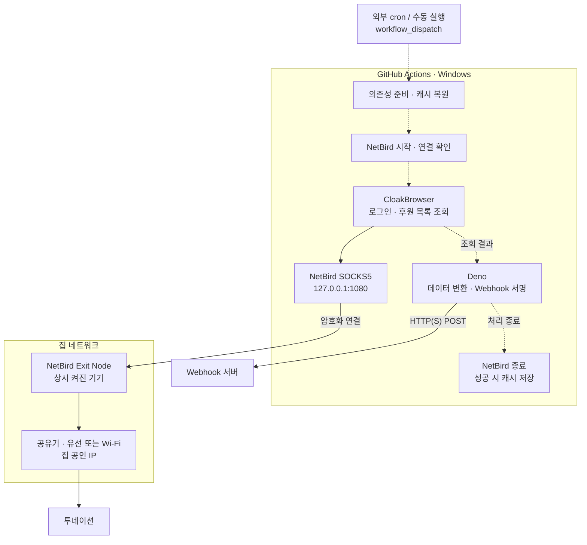

# 투네이션 후원 목록 자동 수집

투네이션 후원 내역을 수집해 Webhook으로 전송하는 Deno 스크립트입니다. 외부 cron이 GitHub Actions를 정기 실행하며, 브라우저 요청은 집 네트워크의 NetBird Exit Node를 경유합니다.

- **세션 재사용**: 저장된 브라우저 프로필을 사용하고, 세션이 만료되면 다시 로그인합니다.
- **후원 수집**: 2016-01-01부터 오늘까지의 내역을 페이지별로 조회합니다.
- **Webhook 전송**: 누적된 후원 목록에 HMAC 서명을 붙여 전송합니다.

## 동작 구조

점선은 실행 순서와 데이터 전달, 실선은 네트워크 요청입니다.



브라우저 요청에만 SOCKS5 프록시가 적용됩니다. Webhook은 Deno에서 직접 전송하며, Exit Node는 아래 NetBird 설정에서 지정합니다.

## 설정

### 1. NetBird Exit Node

계속 켜둘 수 있고 NetBird Exit Node를 지원하는 기기라면 사용할 수 있습니다. Android는 한 가지 예시이며, 집에서 사용하는 PC나 미니 PC 등으로 대체할 수 있습니다. 집 공인 IP로 접속하려면 해당 기기를 집 네트워크에 연결합니다.

1. Exit Node로 사용할 기기와 실행 환경을 같은 NetBird 네트워크에 등록합니다. 크론 실행 중 절전이나 백그라운드 제한으로 연결이 끊기지 않도록 설정합니다.
2. Exit Node용 `exit-nodes`, 실행 환경용 `github-actions` 그룹을 만듭니다. 그룹 이름은 예시입니다.
3. `github-actions` → `exit-nodes` 단방향 ICMP 허용 정책을 설정합니다.
4. 해당 기기를 `exit-nodes`에 넣고, `Peers` → `Add Exit Node`에서 다음을 설정합니다.
   - Distribution Groups: `github-actions`
   - Auto Apply: 활성화
   - Masquerade: 활성화
5. `Settings` → `Setup Keys`에서 키를 생성합니다.
   - Type: `Reusable`
   - Ephemeral Peers: 활성화
   - Auto-assign groups: `github-actions`

Actions는 실행마다 새 피어를 등록하므로 키의 만료일과 사용 횟수 제한을 확인하세요. Ephemeral 피어는 10분 넘게 오프라인이면 자동 제거됩니다.

참고: [Exit Node 설정](https://docs.netbird.io/use-cases/remote-access/exit-nodes), [Setup Key 설정](https://docs.netbird.io/manage/peers/register-machines-using-setup-keys).

### 2. 환경 변수

| 이름 | 용도 |
| --- | --- |
| `TOONATION_ID` | 투네이션 스트리머 계정 아이디 |
| `TOONATION_PASSWORD` | 계정 비밀번호 |
| `WEBHOOK_URL` | 후원 목록을 받을 URL |
| `WEBHOOK_SECRET` | 수신 서버와 공유하는 HMAC 서명 키 |
| `NETBIRD_SETUP_KEY` | Actions에서 NetBird에 등록할 Setup Key |
| `CLOAKBROWSER_LICENSE_KEY` | 최신 CloakBrowser를 다운로드하고 실행할 라이선스 키 |
| `BROWSER_PROFILE_KEY` | Actions 프로필 캐시를 암호화할 64자리 16진수 키 |

**GitHub Actions**에서는 저장소의 `Settings` → `Secrets and variables` → `Actions`에 위 7개 값을 등록합니다. 기존 설정에서 전환한다면 마지막 두 Secret만 추가하면 됩니다.

1. [CloakBrowser](https://cloakbrowser.dev/)에서 라이선스 키를 발급받아 `CLOAKBROWSER_LICENSE_KEY`에 등록합니다. [무료 키](https://cloakbrowser.dev/free)도 최신 브라우저를 제공하며 동시 실행은 1개입니다.
2. `openssl rand -hex 32`로 별도의 암호화 키를 생성하고 출력된 64자리 값을 `BROWSER_PROFILE_KEY`에 등록합니다. 키를 코드나 채팅에 붙여 넣지 마세요.

포터블 프로필은 다른 기기에서도 인증에 사용할 수 있으므로, 캐시에는 프로필 전체를 AES-256-GCM으로 암호화한 `.cache/toonation-profile.enc`만 저장합니다. 쿠키를 별도 파일로 추출하거나 추가 인증 API를 호출하지 않습니다. 암호화 키를 교체하면 다른 캐시를 사용하고 새로 로그인합니다. 두 Secret 중 하나라도 없으면 브라우저 실행 전에 실패합니다.

**로컬 실행**에서는 프로젝트 루트에 `.env`를 만듭니다. Setup Key는 아래 Docker 실행 시 별도로 입력합니다.

```dotenv
CLOAKBROWSER_LICENSE_KEY=your_cloakbrowser_license_key
TOONATION_ID=your_toonation_id
TOONATION_PASSWORD=your_toonation_password
WEBHOOK_URL=https://your.service.example.com/toonation/webhook
WEBHOOK_SECRET=your_webhook_secret
```

로컬에서 프로필 캐시 암호화 명령을 직접 실행하지 않는다면 `BROWSER_PROFILE_KEY`는 필요하지 않습니다.

## 실행

### GitHub Actions

GitHub Actions 자체 스케줄이 불안정해 외부 cron으로 전환했습니다. 실행 주기는 외부 cron에서 관리하며, [Workflow dispatch API](https://docs.github.com/ko/rest/actions/workflows?apiVersion=2026-03-10#create-a-workflow-dispatch-event)로 `cron.yml`을 실행합니다.

외부 cron은 `POST /repos/{owner}/{repo}/actions/workflows/cron.yml/dispatches`를 호출하며, 요청 본문의 `ref`에 실행할 브랜치 또는 태그를 지정합니다. 세분화된 토큰을 사용한다면 대상 저장소의 `Actions: write` 권한이 필요합니다.

`Actions` → `Cron` → `Run workflow`로 수동 실행할 수 있습니다.

| 항목 | 설정 |
| --- | --- |
| 정기 실행 | 외부 cron에서 `workflow_dispatch` 호출 |
| 실행 환경 | Windows 2025, Deno 2.7.11 |
| 브라우저 | CloakBrowser SDK 0.7.1, 실행 시작 시 조회한 최신 안정 Chromium |
| 프록시 | NetBird 0.79.0 직접 실행 · netstack SOCKS5 |
| 캐시 | 브라우저 바이너리와 암호화된 로그인 프로필 재사용 |
| 제한 시간 | NetBird 연결과 크롤링 단계에 10분 |

세부 설정은 [cron.yml](.github/workflows/cron.yml)에 있습니다. 프록시 통신 확인 후 크롤링을 시작하며, 종료 시 NetBird 프로세스를 정리합니다.

실행 시작 시 Windows용 최신 안정 버전을 조회하고 해당 버전의 바이너리 캐시를 복원합니다. 다운로드는 SDK의 서명 검증을 거치며, 조회에 실패하거나 다운로드 결과가 다르면 실행을 중단합니다. 버전 확인 뒤에는 그 실행에서 사용할 버전을 고정합니다. 브라우저 바이너리 폴더만 캐시하며 라이선스 저장 파일과 검증 캐시는 포함하지 않습니다.

기존 Chromium 146에서는 프로필을 다른 Windows 러너에 복원하면 DPAPI 키 복호화가 `0x8009000B`로 실패하는 것을 [Actions에서 확인했습니다](https://github.com/2skydev/toonation-donation-list-cron/actions/runs/42564372076). 서버 세션 쿠키 값이 유지되지 않고 `/dapi/streamer/common`이 `IsLogin: false`를 반환했습니다.

이를 해결하기 위해 Chromium 151 이상에서 지원하는 [`--fingerprint-portable-cookies`](https://github.com/CloakHQ/CloakBrowser#fingerprint-management)를 첫 실행부터 적용합니다. 이전 DPAPI 프로필을 가져오지 않고 `.cache/toonation-profile-portable`과 새 캐시 네임스페이스로 시작하므로, 전환 후 최초 실행은 기존 로그인 화면을 통해 새로 인증해야 합니다. 이후에는 암호화된 프로필을 복원하고, `--restore-last-session`으로 이전 탭과 세션 쿠키를 복원합니다. 인증이 만료되거나 서버에서 거부되면 다시 로그인합니다.

프로필 캐시는 브라우저 버전이 바뀌어도 이어서 사용합니다. 실행은 저장소 내에서 순차 처리하며, 성공적으로 브라우저가 닫힌 뒤 프로필을 암호화하고 성공한 작업의 캐시만 저장합니다.

#### 전환 후 세션 재사용 확인

1. 두 Secret을 등록한 뒤 변경사항이 있는 브랜치를 선택하고 `login_check_only`를 켜서 수동 실행합니다. 이 모드에서는 후원 조회와 Webhook 전송을 생략합니다.
2. 첫 실행이 성공해 캐시 저장까지 끝난 다음, 같은 브랜치에서 같은 설정으로 한 번 더 실행합니다.
3. 두 번째 실행에서 프로필 캐시가 복원됐는지 확인합니다. `cache-hit: false`도 접두사로 기존 캐시를 복원한 경우에는 정상입니다.
4. `browser-diagnostics` 아티팩트에서 첫 실행의 `authenticated.json`과 두 번째 실행의 `browser-started.json`에 기록된 서버 쿠키 `__toonation_session_id__`, `__api_toonation_session_id__`의 `valueHash`를 비교합니다. 두 번째 실행에서 로그인 제출 전 `/dapi/streamer/common` 응답의 `IsLogin`이 `true`이고 최종 `loginSession`이 `reused`인지 함께 확인합니다.

라이선스 키 등록 전에는 최신 브라우저의 실제 실행과 Windows 러너 간 세션 재사용을 검증할 수 없습니다. 첫 실행이 실패하면 프로필 캐시가 저장되지 않으므로, 성공한 최초 실행 이후에 재사용 여부를 판단합니다.

페이지 이동은 `DOMContentLoaded` 이후 로그인 입력창 또는 대시보드 헤더가 나타날 때까지 기다립니다. 로그인 화면에서는 입력창 상위 요소의 진입 애니메이션이 끝난 뒤 입력하고, 캡차 완료로 로그인 버튼이 활성화된 뒤 클릭합니다. 각 대기에는 최대 60초를 허용합니다.

### 로컬 실행(macOS + Docker)

Deno와 Docker가 필요합니다. 브라우저는 Mac에서 화면을 표시하며 실행됩니다.

**1. NetBird 프록시 시작**

Docker를 실행한 뒤 zsh에서 Setup Key를 입력합니다.

```zsh
read -rs "NB_SETUP_KEY?NetBird Setup Key: "
echo
export NB_SETUP_KEY

docker run --detach \
  --name netbird-local \
  --hostname toonation-local \
  --publish 127.0.0.1:1080:1080 \
  --env NB_SETUP_KEY \
  --env NB_USE_NETSTACK_MODE=true \
  --env NB_SOCKS5_LISTENER_ADDRESS=0.0.0.0 \
  netbirdio/netbird:0.79.0-rootless

unset NB_SETUP_KEY
```

SOCKS5는 인증이 없으므로 호스트에는 `127.0.0.1:1080`으로만 공개합니다.

**2. 연결 확인 후 수집 실행**

```bash
docker exec netbird-local netbird status
docker exec netbird-local netbird networks ls
```

설정한 Exit Node 경로가 선택되어 있으면 프로젝트 폴더에서 실행합니다. 필요한 의존성과 브라우저는 첫 실행 시 자동으로 다운로드됩니다.

```bash
deno task start
```

`.env`를 읽어 후원 내역을 수집하고 Webhook으로 전송합니다. 로그인 프로필은 `.cache/toonation-profile-portable`에 저장됩니다. 파일 변경 시 재실행하려면 `deno task dev`를 사용합니다.

**3. 프록시 종료**

```bash
docker rm --force netbird-local
```

다시 사용할 때는 1번부터 실행합니다.

## Webhook 연동

`WEBHOOK_URL`로 아래 형식의 JSON 배열을 POST 전송합니다.

```json
[
  {
    "account": "acc123",
    "nickname": "닉네임",
    "amount": 5000,
    "message": "응원합니다!",
    "createdAt": "2024-05-10T09:15:27.123Z"
  }
]
```

| 응답 | 처리 |
| --- | --- |
| 2xx | 수집 종료 |
| 404 + 본문 `not-found-last-donation` | 다음 페이지를 추가해 누적 목록 재전송 |
| 그 외 오류 | 실행 실패 |

현재 구현에서는 추가 페이지 조회가 끝나도 최초 404를 오류로 처리합니다.

<details>
<summary>서명 검증 방법</summary>

요청에는 다음 헤더가 포함됩니다.

- `Content-Type: application/json`
- `X-Signature-Timestamp`: Unix 타임스탬프(초)
- `X-Signature-Sha256`: HMAC-SHA256 서명(hex)

수신 서버는 JSON 파싱 전의 원본 본문으로 서명을 계산합니다.

```text
HMAC_SHA256_HEX(WEBHOOK_SECRET, timestamp + rawBody)
```

타임스탬프가 허용 범위(예: 300초) 안인지 확인하고, 서명을 constant-time 방식으로 비교한 뒤 데이터를 처리합니다. 구현은 [webhook.ts](webhook.ts)를 참고하세요.

</details>

## 문제 해결

| 증상 | 확인할 내용 |
| --- | --- |
| `ERR_PROXY_CONNECTION_FAILED` | `127.0.0.1:1080` 프록시 실행 여부 |
| 라이선스 오류 | `CLOAKBROWSER_LICENSE_KEY` 등록, 키 유효성, 다른 기기에서 실행 중인 브라우저 수 |
| 프로필 암호화 또는 복원 실패 | `BROWSER_PROFILE_KEY`가 64자리 16진수인지 확인. 복호화 실패 시 해당 캐시를 삭제하고 새로 로그인 |
| `NetBird login failed` | Setup Key 만료·폐기·사용 횟수 제한 |
| NetBird 연결 후 요청 실패 | Exit Node 기기의 네트워크 연결, 경로 선택, 그룹과 접근 정책 |
| 로그인 실패·화면 대기 초과 | 계정 정보, 캡차·2단계 인증, 페이지 구조 변경 |
| Webhook 401/403 | 공유 서명 키, 원본 본문, 타임스탬프 |

집 공인 IP는 같은 SOCKS5 프록시를 지정해 별도로 확인하세요. Actions의 통신 검사는 IP를 비교하지 않으며, Exit Node와 같은 집 네트워크에서 테스트하면 직접 연결도 같은 IP를 사용합니다.

<details>
<summary>로그와 주요 파일</summary>

Actions의 NetBird 로그는 `%PROGRAMDATA%\Netbird\client.log`에 기록됩니다. 표준 출력과 오류는 러너 임시 디렉토리의 `netbird/service.log`, `netbird/service-error.log`에 기록됩니다.

브라우저 진단은 Actions 로그와 `browser-diagnostics-실행ID-시도번호` 아티팩트에 기록되며, 아티팩트는 7일간 보관됩니다.

- `profile.json`: 캐시 복원 여부와 브라우저 실행 전 프로필 파일의 존재 여부. 정확한 캐시 키는 `Cache browser profile` 단계의 로그에 기록됩니다.
- `profile-after-launch.json`, `profile-after-close.json`: 실행 전후 쿠키 DB의 이름과 속성, 암호화된 값의 해시, OS 암호화 키의 암호문 해시와 Windows DPAPI 복호화 성공 여부. DB는 읽기 전용으로 조회하며 복호화된 키는 기록하지 않습니다.
- `auth-network.jsonl`: 대시보드와 로그인 상태 확인 요청의 상태 코드, 리디렉션 경로, 전송 및 발급 쿠키의 이름과 해시, `IsLogin`과 숫자 상태 코드만 기록합니다. 응답 본문과 원본 헤더는 저장하지 않습니다.
- `browser-started.json`: 페이지 접속 전 인증 쿠키의 존재 여부와 만료 정보
- `login-required.json`, `before-login-click.json`: 로그인 화면, 입력 여부, 로그인 버튼과 캡차 토큰의 준비 상태
- `authenticated.json`: `loginSession`이 `reused`이면 재로그인 없이 대시보드에 진입했고, `new-login`이면 이번 실행에서 로그인했습니다.
- `failure.json`, `failure.png`: 실패 시 상태와 화면. 입력 필드는 가리며, 로그인 화면 외 페이지는 본문 전체를 가립니다.

쿠키 진단에는 `toon.at`과 하위 도메인의 모든 경로에 있는 쿠키를 포함해 서버 인증용 HttpOnly 쿠키도 비교합니다. 쿠키 값, 비밀번호, 캡차 토큰 값, URL의 쿼리와 해시는 진단에 포함하지 않습니다. 쿠키 값은 일치 여부를 비교하는 SHA-256 해시만 기록합니다. 원본 프로필과 HTML도 아티팩트에 올리지 않습니다.

세션만 확인하려면 `Run workflow`에서 `login_check_only`를 선택합니다. 후원 조회와 Webhook 전송 없이 로그인까지만 진행하며, 두 번 연속 실행해 두 번째 실행의 `authenticated.json`이 `reused`인지 확인합니다. 캐시가 복원됐더라도 인증 쿠키가 없거나 만료되었거나 서버에서 거부되면 재로그인이 필요합니다.

| 파일 | 역할 |
| --- | --- |
| [main.ts](main.ts) | 브라우저 실행, 로그인, 수집·전송 |
| [toonation.ts](toonation.ts) | 후원 목록 API 조회 |
| [webhook.ts](webhook.ts) | Webhook 서명 및 전송 |
| [config.ts](config.ts) | 환경 변수 검증 |
| [profile-cache.ts](profile-cache.ts) | 프로필 전체 암호화와 복원 |
| [.github/workflows/cron.yml](.github/workflows/cron.yml) | 외부 호출·수동 실행, NetBird, 캐시 |

</details>
